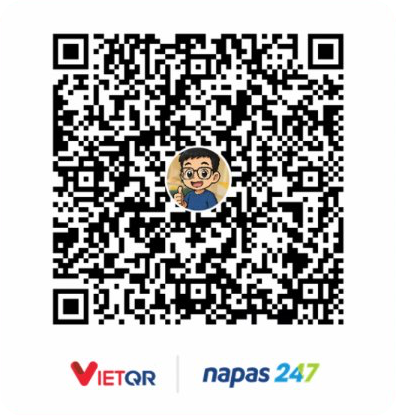

# Memory Lane

**Shared long-term memory and core instructions across every AI client, because "per my last prompt" shouldn't be part of your workflow.**

Memory Lane is a small [MCP](https://modelcontextprotocol.io) server. Connect it to Claude, ChatGPT, Cursor, Codex or any MCP client so they all read and write the same memories and follow your Core instructions. The Web UI runs locally without sign-in; MCP clients connect locally or to a deployed server with one token.

**Tech stack:** TypeScript, Node.js 22+, `@modelcontextprotocol/sdk`, PostgreSQL ([Neon](https://neon.tech)) / embedded [PGlite](https://pglite.dev), Vercel.

## Features

- **Versioned Core instructions:** one document returned first on `memory_search`, with `core_version` caching and optimistic locking.
- **Write-time guardrails:** exact and `pg_trgm` near-duplicate detection, English-only check, length/rate limits, and `dry_run` preview.
- **Newest-first search:** word and trigram matching ranked newest first with dates so newer facts win.
- **Cleanup proposals:** `memory_propose` groups related memories for manual review in the local Web UI (`/memory/review`).
- **One SQL, two engines:** runs on serverless PostgreSQL ([Neon](https://neon.tech)) in production and embedded [PGlite](https://pglite.dev) locally.

## Quick start

Requires Node.js 22 or newer.

```bash
npm install
npm start                  # local Web UI at http://127.0.0.1:4173/memory (PGlite)
npm start -- --db neon     # connect the local UI and MCP to Neon instead
npm test                   # run tests on PGlite
npm run typecheck
```

## Documentation

- [Usage guide](docs/usage.md) — local runner, Neon mode, Vercel deployment, connecting AI clients, Core CLI, HTTP API, and security.
- [Architecture & development](docs/architecture.md) — project structure, storage engines, local UI boundaries, and tests.
- [Decisions log](docs/decisions.md) — non-obvious design choices and rationale.

## Support

- **International:** [Support on Ko-fi](https://ko-fi.com/nqnhut92)
- **Vietnam (MoMo / VietQR):**

<details>
<summary>Show MoMo / VietQR code (0% fee · scan with any Vietnamese banking app)</summary>



</details>
